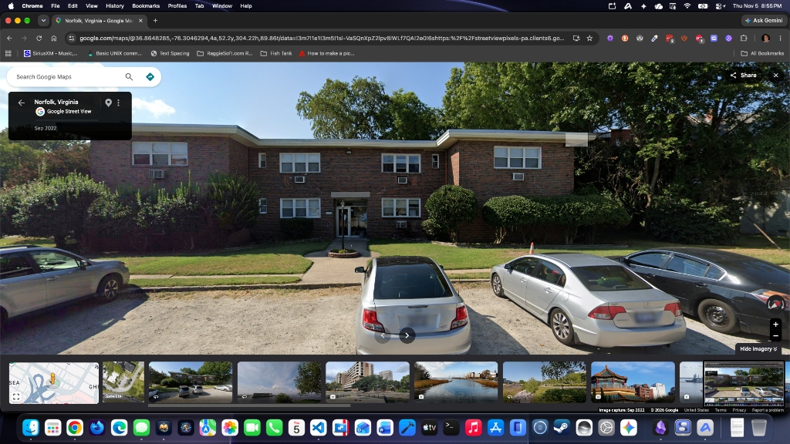
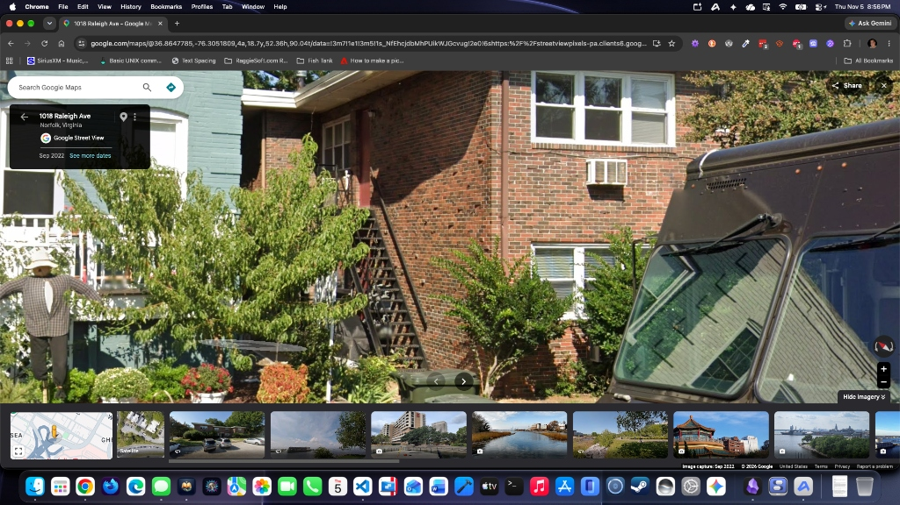

# 801 Greenway Court: Universal Location & Architectural Lore Bible

- **Official In-Universe Address**: **`801 Greenway Court, Norfolk, VA 23507`** *(West Ghent neighborhood, Norfolk, Virginia — located near Redgate Avenue and the Hampton Boulevard / `SR-337` corridor)*.
- **Owners & Landlords**: **Dave and Deb** (a warm, no-nonsense husband-and-wife couple in their fifties who own and manage the building independently through their local LLC without corporate leasing offices or predatory red tape).
- **Nearest Public Transit (`CVTA`)**:
  - **`CVTA Route #2` (`Hampton Boulevard` / `Naval Station Norfolk` $\leftrightarrow$ `Virginia Dominion University [VDU]` $\leftrightarrow$ `Downtown Norfolk`)**
  - **`CVTA Route #4` (`Colley Avenue / Ghent` $\leftrightarrow$ `Sentara Norfolk General` $\leftrightarrow$ `Downtown Norfolk`)**
- **Cross-Narrative Role**: Serves as a shared post-high-school independent studio apartment building in both **`/raggiesoft-narratives/books/rachel`** (*The Story of Rachel*, **Apartment A5**) and **`/raggiesoft-narratives/books/katie`** (*Bonded by Limitations: The Story of Katie and Nathaniel*, **Apartment A6**).

---

## 1. Exterior Architecture & Streetscape Context (From Google Street View Reference Imagery)

### A. Front Facade, Parking Lot, & Opposite Grassy Field (`801-greenway-court-front-exterior.jpg`)

- **Building Massing & Brickwork**:
  - A symmetrical, two-story, flat-roofed mid-century red-brick apartment building with clean white overhanging eaves/fascia trim.
  - The front facade is divided into **two slightly projecting outer brick wings** (left and right) flanking a **recessed central bay**.
  - **Window & Through-Wall A/C Grid**: Multi-pane white-framed windows (`3-pane` wide studio windows and smaller `1-pane` frosted bathroom windows) are arranged symmetrically across the first and second floors. Directly beneath each studio window, a rectangular white-grilled **through-wall box air conditioning (`A/C`) unit** is mounted straight through the red-brick masonry.
- **Decal-Controlled Front Parking Lot, Split Front Lawn, & Lamppost Planter**:
  - Along the street curb of Greenway Court directly in front of the building runs a paved, **decal-controlled head-in parking lot** separated from the front grass by a concrete sidewalk.
  - Two manicured green grass lawns flanked by mature foundation bushes and shade trees sit in front of the left and right brick wings.
  - Down the center, a concrete front walkway leads from the parking lot sidewalk to the recessed main entrance, splitting around a small **circular red-brick planter ring** with a **black metal post lamp** standing directly in front of the entrance doors.
- **24/7 Key-Locked Main Entrance Door & Front Lobby**:
  - Set inside the recessed central brick bay under a flat white concrete lintel is a **white-framed glass-and-aluminum main entrance door** with vertical glass sidelights.
  - **Strict 24/7 Locked Perimeter**: The front entrance door remains **locked 24 hours a day, 7 days a week**. No one can enter the interior lobby from the street without inserting a tenant's **brass apartment key**.
  - **Interior Lobby, Mailboxes, & 3 Shallow Steps / Modular Ramp**: Stepping inside the air-conditioned front lobby, a bank of standard **locking metal mailboxes** lines the wall. Just past the mailboxes, the lobby floor rises via **three shallow steps coated in thick, heavy-duty black industrial rubber with raised circular traction grips** (providing high-friction footing for Michael Ragsdale's CP gait, and fitted with a **short nonslip aluminum modular ramp** installed by Dave so Katie and Nathaniel Prairie's compact `SwiftChair` power wheelchairs can roll smoothly into the first-floor corridor).
- **Across the Street (The Open Grassy Field & Dog-Walking Benches)**:
  - Directly opposite `801 Greenway Court` across the quiet residential street sits a small, open **grassy field** shaded by mature trees and furnished with **slatted wooden park benches**, where neighborhood residents walk their dogs in the morning and where tenants step outside to get **three full bars of cellular reception** (since the thick red-brick walls of the building attenuate cell phone signals inside the rear apartments down to a single bar).

---

### B. Rear Alley, Exterior Black Iron Staircase, & Rear First-Floor Windows (`801-greenway-court-rear-alley-and-iron-stairs.jpg`)

- **Narrow Rear Alleyway (Accessed from the `1018 Raleigh Avenue` Side)**:
  - Behind `801 Greenway Court` runs a narrow, utilitarian first-floor service alley bordered closely by neighboring painted wood-siding houses, dense bushes/shrubs, and green wheeled municipal trash bins.
- **Black Iron Exterior Staircase & Rear Brick Wall**:
  - Bolted against the rear red-brick wall of `801 Greenway Court` is a steep **black iron exterior fire-escape staircase** with metal handrails climbing up to a red-painted second-floor rear service door under the white eaves.
- **Location of Rear First-Floor Windows (`Apartment A5` & `Apartment A6`)**:
  - The rear ground-floor windows of **`Apartment A5`** and **`Apartment A6`** face this back alley **behind the black iron staircase and foundation bushes**.
  - Just like the front facade, each apartment has a wide **three-pane white-framed window** with white horizontal mini-blinds and a **rectangular white-grilled through-wall box A/C unit** mounted through the red-brick wall below/beside the window line.
  - **Narrative Geography Note (`Brenda's Rear-Alley Window Confrontation in books/katie/e004/c002/p002.md`)**: Because the front glass-and-aluminum lobby door of `801 Greenway Court` requires an apartment key 24/7, Katie and Nate's estranged mother **Brenda** cannot enter the front hallway when she tracks them down in July 2003. Instead, Brenda has to walk around the building into this narrow back alley behind the black iron staircase to reach the first-floor rear window of **Apartment A6** and bang on the glass beside the humming through-wall A/C unit—prompting eighteen-year-old Katie and Nate to retreat into their **square walk-in closet**, zip their two sleeping bags together on the carpet with the closet door shut, and fall asleep in each other's arms.

---

## 2. Universal 20-Unit Floor Plan & Mirror-Image Studio Architecture

### A. Building Numbering (`20 Units Total`: `A1–A10` Downstairs, `B1–B10` Upstairs)
- **First Floor (`Ground Floor`)**: **10 Apartments (`Apartment A1` through `Apartment A10`)** arranged along the central interior hallway (`A1–A2` at the front toward Greenway Court; `A5` and `A6` directly across the hall from each other at the back of the building facing the rear alley).
- **Second Floor (`Upstairs`)**: **10 Apartments (`Apartment B1` through `Apartment B10`)** stacked directly above the `A` units in the exact same corridor grid.

### B. Identical Studio Layout Across All 20 Apartments & Left/Right Mirror-Image Geometry
- **Canonical Rule**: **All 20 apartments (`A1–A10` and `B1–B10`) share the exact same layout**—an **enlarged bedroom-style rectangular studio apartment** (~350–400 sq. ft.) designed for one person (or a close-knit pair sharing a single rectangular perimeter).
- **Mirror-Image Pairing Across the Central Hallway (`Apartment A5` $\leftrightarrow$ `Apartment A6`)**:
  - Units on opposite sides of the central interior hallway—specifically **`Apartment A5`** and **`Apartment A6`** at the back of the first floor—share the **exact same layout as left/right mirror images of each other**:
    1. **Entry Door & Deadbolt**: Solid wooden hallway door equipped with a heavy brass deadbolt that echoes with a distinct metallic *thunk* in the quiet corridor.
    2. **Enlarged Bedroom-Style Rectangular Main Room**:
       - Combines the living, sleeping, and workstation zones into a single, clearly defined rectangular room with zero wasted space.
       - Features a wide **3-pane white-framed exterior window** with horizontal mini-blinds and a **through-wall box air conditioner** mounted into the red brick beneath the window.
       - Comfortably accommodates a **full-sized bed** (in `Apartment A6` for Katie & Nate) or a **pull-out queen sleeper sofa** (the Delaney Street sofa in `Apartment A5` for Michael & Ashley), a tall wooden dresser, a 17-inch CRT television on a compact stand with rabbit-ear antennas, and a **shared computer workstation desk** holding a desktop PC tower and 17-inch CRT monitor.
    3. **Compact Kitchenette & The Mandatory Standalone Microwave Cart**:
       - Tucked along the front interior corner of the studio with a **four-burner stove**, a **single stainless-steel sink**, and a **single narrow square of speckled laminate countertop prep space** positioned directly above an **under-the-counter dorm/mini-refrigerator**.
       - Because the under-the-counter dorm fridge leaves only a single square of prep counter, **tenants in both `Apartment A5` (Ellen & Ashley) and `Apartment A6` (David Prairie for Katie & Nate) purchase a standalone rolling utility cart** to hold a **countertop microwave and toaster** next to the kitchenette counter.
    4. **Square Walk-In Closet (`The First Closet Sanctuary in Apartment A6`)**:
       - A **square walk-in closet** with a soft carpeted floor, an upper hanging rod/shelf, and a solid interior door that latches shut.
       - In **`Apartment A6`**, this square closet is where eighteen-year-old Katie and Nate first discover that sleeping zipped together inside a shared double sleeping bag on a dark, enclosed closet floor makes them feel completely safe and regulated when their mother Brenda bangs on their rear alley window (`books/katie/e004/c002/p002.md`)—establishing the lifelong autistic deep-pressure closet sanctuary they later recreate in the hallway closet at `233 W. Ocean View Ave, Apt. #3`.
    5. **Accessible Bathroom (`Standing Shower with High-Grip Acrylic Pan & Roll-Under Sink`)**:
       - Separate bathroom with a small frosted exterior window, a **roll-under sink**, a **toilet**, and a **dedicated standing shower** (no bathtub) built with a **textured, high-grip non-slip acrylic shower pan**—providing safe traction for Michael's Cerebral Palsy legs in `Apartment A5`, and outfitted with a **sturdy padded shower transfer bench and handheld sprayer** by David Prairie for Katie and Nate in `Apartment A6`.

---

## 3. Master Occupancy Registry (`801 Greenway Court` — Active vs. Available Units)

> **AI & Author Continuity Rule**: Before assigning any new character or storyline to `801 Greenway Court`, always check the **Master Occupancy Registry** below so active units (`Apartment A5` and `Apartment A6`) are never double-booked during their canonical timeframes, and so cross-narrative hallway encounters remain 100% consistent across all Ocean View Archives books.

| Unit Number | Floor & Position | Mirror-Image Pair | Canonical Status & Active Timeframe | Occupants & Narrative Appearances |
| :--- | :--- | :--- | :--- | :--- |
| **`Apartment A5`** | **1st Floor (Ground)** — Rear of building (facing rear alley behind black iron stairs) | Mirror image of **`Apartment A6`** across the hall | **IN USE (`July 15, 2003 – November 2004`)** | • **Occupants**: **Michael Ragsdale** (`July 15, 2003 – Nov 2004`), **Ashley Raybourn** (`July 15 – late Aug 2003` & `May – Aug 2004` college breaks), and one-eyed black Lab rescue **Archie** (`July 16, 2003 – Sept 2, 2004`). *(Guarantor: **Ellen Ragsdale**; visited by **Delores** in `2004` before Michael vacates in Nov 2004).* • **Primary Book**: **`/raggiesoft-narratives/books/rachel`** (*The Story of Rachel*, **Episodes 13, 14, & 15**). |
| **`Apartment A6`** | **1st Floor (Ground)** — Rear of building (directly across the hall from `A5`, facing rear alley behind black iron stairs) | Mirror image of **`Apartment A5`** across the hall | **IN USE (`July 1, 2003 – February 2005`)** | • **Occupants**: Fraternal twins **Katie Prairie** (`July 1, 2003 – February 2005`) and **Nathaniel ("Nate") Prairie** (`July 1, 2003 – August 2004`, when Tiffany Sloan convinces Nate to move to `Sea Breeze West Apt. #3`, leaving Katie in `Apartment A6` until **Brandon Mercer** convinces her to move to Williamsburg in `February 2005`). *(Lease signed and paid for by their father **David Prairie** so his children have their own safe apartment after turning 18).* • **Primary Book**: **`/raggiesoft-narratives/books/katie`** (*Bonded by Limitations: The Story of Katie and Nathaniel*, **Episode 4, Chapters 2–3** & **Episode 5, Chapter 1** — including the `July 16, 2003` hallway reunion with Michael & Ashley across the hall in `books/katie/e004/c002/p001.md` and `books/rachel/e013/c004/p001.md`). |
| **`Apartments A1 – A4`** & **`Apartments A7 – A10`** | **1st Floor (Ground)** | `A1` $\leftrightarrow$ `A2`, `A3` $\leftrightarrow$ `A4`, `A7` $\leftrightarrow$ `A8`, `A9` $\leftrightarrow$ `A10` | **AVAILABLE** *(Unassigned in canon)* | Available for future first-floor characters or neighbors (sharing the identical rectangular studio layout). |
| **`Apartments B1 – B10`** | **2nd Floor (Upstairs)** — Accessed via interior stairs or rear black iron exterior stairs | `B1` $\leftrightarrow$ `B2`, `B3` $\leftrightarrow$ `B4`, `B5` $\leftrightarrow$ `B6`, `B7` $\leftrightarrow$ `B8`, `B9` $\leftrightarrow$ `B10` | **AVAILABLE** *(Unassigned in canon)* | Available for future second-floor characters or neighbors (sharing the identical rectangular studio layout). |

